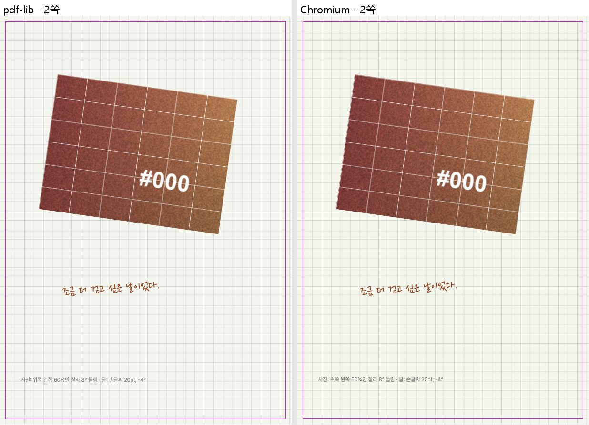
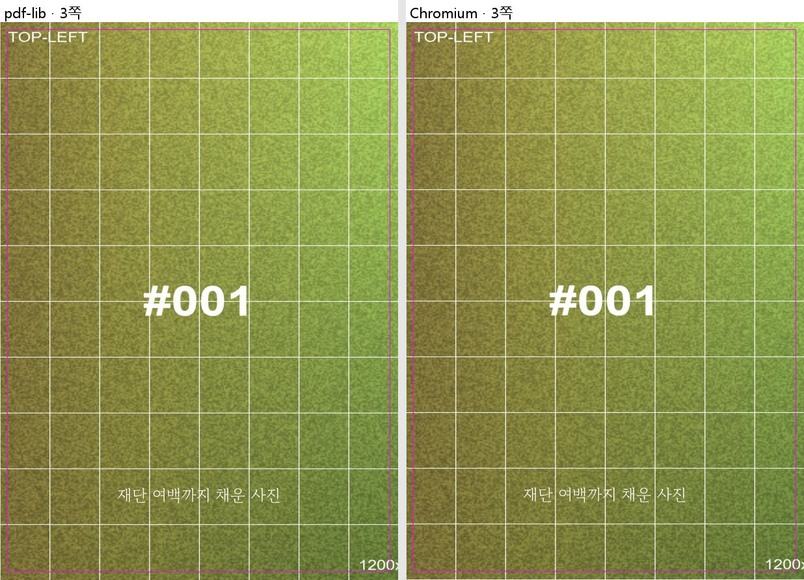
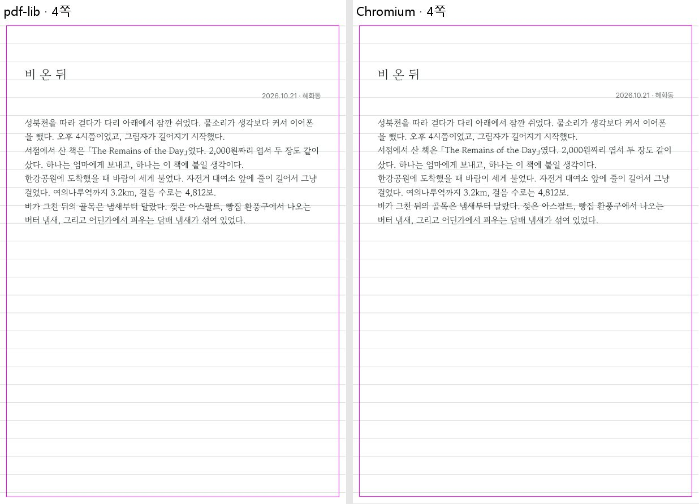
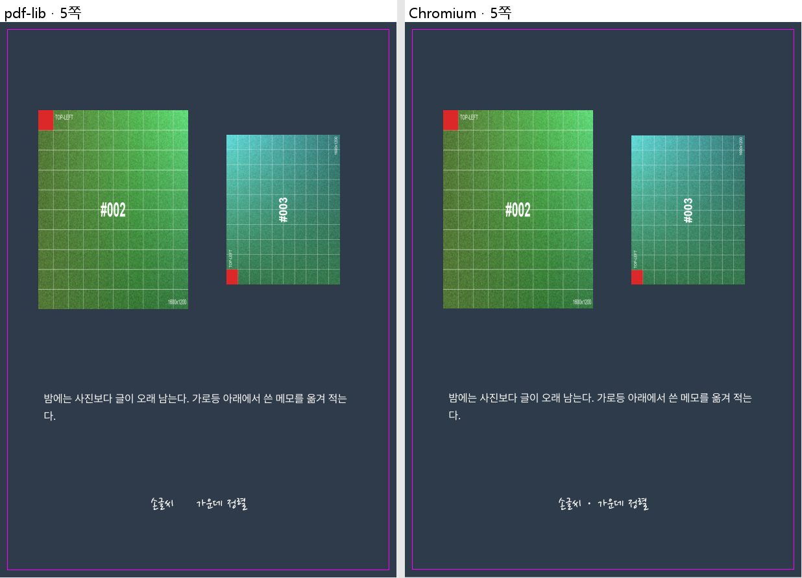
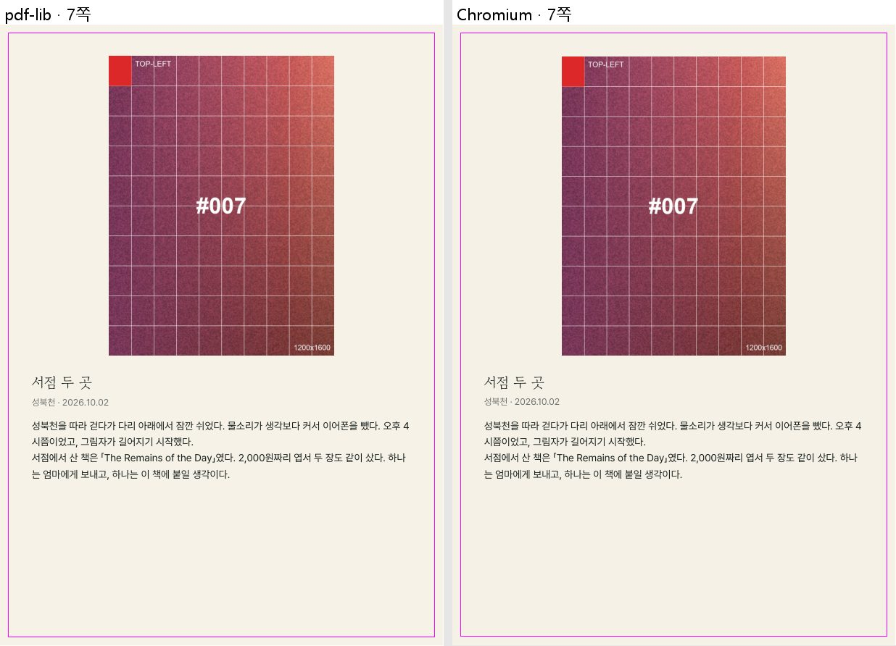
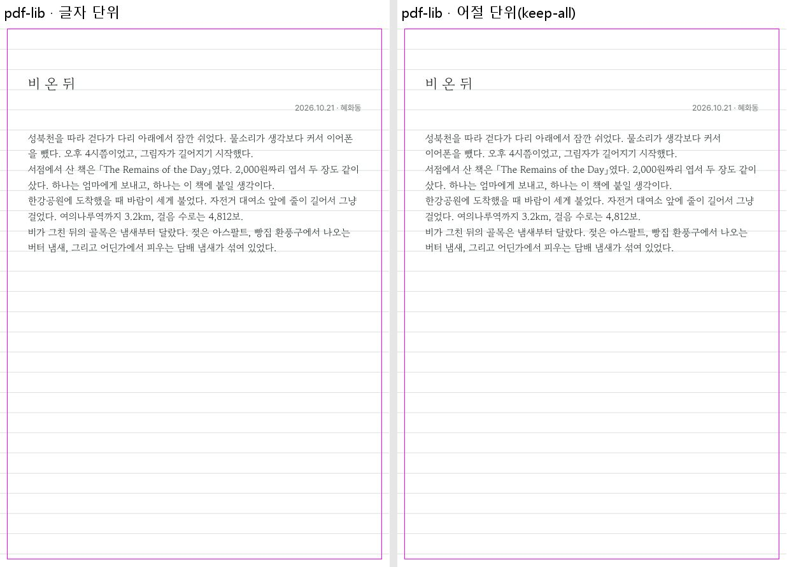

# 인쇄용 PDF 렌더러 스파이크 결과

- 날짜: 2026-11-18
- 코드: [`spikes/book-pdf/`](../spikes/book-pdf/README.md)
- 범위: 로컬 실행만 했습니다. 운영 데이터 읽기, 배포, 앱·Functions 의존성 변경은 없습니다.

## 결론: **pdf-lib(접근 A)로 갑니다. 단, 조건이 4가지 있습니다.**

| 판정 | 질문 | 근거 |
|---|---|---|
| **검증됨** | 앱 데이터(mm 좌표)를 그대로 PDF로 옮길 수 있나 | 회전, 크롭, 풀블리드, -90° 사진, 모눈·줄지 배경, 세 글꼴, 정렬이 Chromium 결과와 눈으로 구분되지 않습니다(아래 그림). M4의 `pdfCoords.ts` 행렬을 그대로 썼습니다. |
| **검증됨** | 한글 3종을 subset으로 넣을 수 있나 | 고운바탕(전체 8.4MB), 나눔손글씨 펜, Pretendard OTF 모두 Type0로 embed와 subset이 됩니다. 텍스트 추출 결과는 원문과 같습니다(301개 글 상자 중 300개, 남은 1개는 아래 "빠진 글자"). |
| **검증됨** | 줄바꿈이 브라우저와 같은가 | 200쪽 중 **199쪽**에서 줄 단위 텍스트가 Chromium과 같습니다. 글자 단위와 어절 단위 두 방식 모두 그렇습니다. 다른 1쪽은 빠진 글자 때문입니다. |
| **검증됨** | 200쪽을 2GiB 안에서 만들 수 있나 | pdf-lib는 **1.6초**, 최대 메모리 **279MB**, 결과 파일 43.7MB입니다. Chromium은 19.4초이고, Chrome 프로세스 600MB에 Node 242MB를 더 씁니다. |
| **일부만** | 앱 화면과 줄바꿈이 같은가 | 앱(React Native)은 따로 설정하지 않아 한글을 글자 단위로 끊습니다. PDF도 같은 방식으로 맞췄지만, 실제 기기의 줄바꿈과 비교하지는 않았습니다. |

## 측정값 (200쪽, 사진 245장(서로 다른 1600px JPEG 149장, 45MB), 글 상자 301개)

Windows 11, Node 26.7, 로컬 Chrome 158에서 잰 값입니다. Cloud Functions(Linux, Node 24, `@sparticuz/chromium`)에서는 다시 재야 합니다. 원본 기록은 [`results/runs.json`](../spikes/book-pdf/results/runs.json)에 있습니다.

| | pdf-lib | Chromium |
|---|---|---|
| 시간 | 1.6초 (글 1.3초, 저장 0.2초) | 19.4초 (인쇄 17.1초, 상자 추가 1.6초) |
| 메모리 최대 | 279MB (Node 프로세스 전체) | Chrome 600MB + Node 242MB |
| PDF 크기 | 43.7MB (subset 없이 47.8MB) | 43.9MB |
| 페이지 크기 | 154.00 × 216.00mm 정확 | **154.18 × 215.90mm** (pt 정수로 반올림됨) |
| TrimBox/BleedBox | 직접 넣음 | 없음. pdf-lib로 후처리 필요 |
| Pretendard | Type0 embed + subset | **Type3로 출력됨** (CFF 글꼴) |
| 배포 | 순수 JS, 의존성 3개 | `@sparticuz/chromium` 70MB, 권장 RAM 1,600MB, 시스템 한글 글꼴 없음 |

## 비교 이미지 (보라색 선 = TrimBox)

| | |
|---|---|
| 회전 + 크롭 사진, 손글씨 -4° |  |
| 풀블리드 사진 + 흰 글 |  |
| 줄지 + 명조 긴 글, 오른쪽 정렬 |  |
| 어두운 배경, -90° 사진, 손글씨 가운데 정렬 (빠진 `·`) |  |
| 자동 배치 기록 쪽 |  |
| 글자 단위와 어절 단위(`keep-all`) 비교 |  |

## 발견한 문제와 해결

1. **pdf-lib에 들어 있는 fontkit 포크가 Pretendard OTF를 읽지 못합니다.**
   - 증상: `@pdf-lib/fontkit` 1.1.1이 "Not a CFF Font" 오류를 냅니다. CID 방식 CFF 글꼴은 줄바꿈 측정조차 안 됩니다.
   - 해결: 원본 fontkit 2(2026-11 갱신)는 이 글꼴을 읽고 subset할 수 있습니다. pdf-lib가 부르는 `encodeStream()`만 감싸면 됩니다(`fontkitAdapter.mjs`, 15줄).
2. **pdf-lib의 기본 속도 설정 때문에 매우 느렸습니다.**
   - 증상: Chromium PDF에 TrimBox를 넣는 데 **3분**이 걸렸습니다(읽기 38초 + 저장 142초).
   - 원인: pdf-lib는 기본값으로 작은 묶음마다 이벤트 루프에 양보합니다.
   - 해결: `ParseSpeeds.Fastest`와 `objectsPerTick: Infinity`를 쓰면 0.1초입니다.
3. **줄바꿈을 매번 처음부터 측정하면 느립니다.**
   - 증상: 줄을 채울 때마다 앞부분 전체를 다시 shaping하면 200쪽에 11초가 걸리고, 그중 98%가 글 처리였습니다.
   - 해결: 글자별 폭을 누적합으로 계산하면 1.3초입니다. 커닝은 빠지지만, 결과 줄은 Chromium과 같았습니다.
4. **빠진 글자가 있습니다.** 나눔손글씨 펜에는 `·` `「` `…` `♥` 같은 글자가 없습니다.
   - Chromium은 로컬 Windows 글꼴로 대신 그렸고, pdf-lib는 빈칸(.notdef)으로 그렸습니다.
   - Cloud Functions의 Chromium에는 한글 시스템 글꼴이 없어서, 두 방식 모두 대체 글꼴을 직접 지정해야 합니다.
   - 앱도 이 글자를 시스템 글꼴로 대신 보여 주기 때문에, 화면과 인쇄 결과가 다를 수 있습니다.
5. **Chromium 출력이 인쇄 규격과 맞지 않습니다.**
   - 페이지 크기가 0.18mm, 0.1mm 어긋납니다.
   - CFF 글꼴이 Type3로 나옵니다. PDF/X 사전 검사에서 거부되거나 경고받을 수 있습니다(업체 기준 확인 필요).
   - TrimBox가 없습니다.

## 실제 구현 전에 할 일 (권고)

1. **렌더러는 pdf-lib 1.17.1 + fontkit 2 어댑터로 만듭니다.** `pdfCoords.ts`, `preflight.ts`, `textLayout`(스파이크 코드를 정리해 `src/lib/book`으로 옮기고 테스트 추가)을 앱과 같이 씁니다. pdf-lib는 npm 기준 2022-05 이후 갱신이 없으므로, 고정 버전 위에서 회귀 테스트(이 스파이크의 비교)를 유지합니다.
2. **빠진 글자를 처리합니다.**
   - (a) 미리보기 검사에 "이 글꼴에 없는 글자" 경고를 추가합니다. 앱에 글꼴의 cmap 목록을 넣습니다.
   - (b) 렌더러는 글자 단위로 Pretendard로 대신 그립니다. 앱도 같은 대체 규칙을 써야 화면과 인쇄가 같아집니다.
3. **실기기 줄바꿈을 비교합니다.**
   - Android와 iOS에서 같은 글 상자의 줄을 캡처해 PDF와 비교합니다.
   - 어절 단위로 바꾸려면 앱의 `lineBreakStrategyIOS="hangul-word"`, Android `lineBreakStrategy`와 PDF의 `keep-all`을 함께 바꿉니다. 지금 표본에서는 줄 수 차이가 없었지만, 줄 끝 단어는 바뀝니다.
4. **사진 축소:** 원본 보관(B1) 뒤에는 사진을 배치 크기 × 300dpi로 줄여서 넣습니다(`sharp`). pdf-lib는 넣은 사진을 모두 메모리에 들고 있습니다.
5. **업체 규격을 확인합니다(스위트북).** CMYK나 PDF/X가 필요한지, 블리드·안전 여백, 표지 PDF와 책등 폭을 확인합니다. CMYK가 필요하면 pdf-lib만으로는 변환할 수 없어서 Ghostscript 같은 별도 단계가 필요합니다.
6. **Functions 실측:** 2세대, 2GiB, Node 24에서 200쪽 시간과 메모리를 다시 잽니다. 배포는 승인을 받은 뒤에 합니다.
